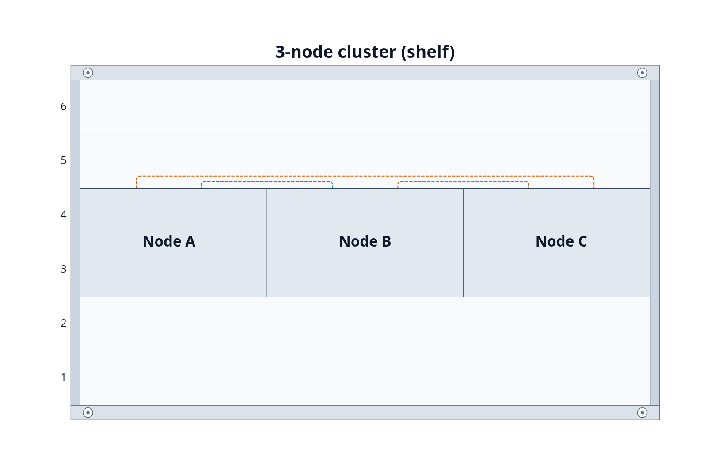

# RackDown

**Write or record the rack, RackDown draws it.**

RackDown describes equipment racks in plain text and turns them into diagrams.
Keep the source in notes, Git, review changes as text, and then render the same rack in different tools.
The document stays readable even without using the renderer.

```rackdown
rack "Example Rack" 8U 19in u1 bottom views front rear

8 switch "Core" as core
5 2U server "Host" as host
rear 2 pdu "Power" as power

core:1 -- host:"NIC 1" adhoc
core:2 -- [[Upstream Rack]]
power:1 -- host:power1
```

> [!NOTE]
> Want To Contribute?
>
>Do you see any issues, does the syntax suck, maybe you have suggestions, or fixes, please open an issue otherwise you could submit a pull request.
>Connector routing and layout is something that needs love and attention, so feel free to contribute improvements or suggestions.
>Do I have too much waffling here, or too much text perhaps?
>Just imagine, you could help fix that problem! YES, YOU!
>
>See [contributing](CONTRIBUTING.md) for more fun and excitement!

Routing or connection options are also available within RackDown, supporting mini clusters, power, etc. _(Please check the examples folder)_

For example:

```rackdown
rack "3-node cluster (shelf)" 6U

3 2U shelf "Shelf"
3 2U device "Node A" as a
3 2U device "Node B" as b
3 2U device "Node C" as c

a:nic1 -- c:nic2
b:nic1 -- a:nic2
b:nic2 -- c:nic1
```

<a href="examples/generated/3-node-shelf.png">
  
</a>

Try it in the playground with `pnpm dev`. The diagram shows front and rear views
in the declared order, with external targets shown as annotations. More
[examples](examples/) cover catalogue devices, routing and shared rows.

> [!NOTE]
> Please note that I'm not a software developer by trade and this project is an experiment due to my dripping hatred of rack diagrams being created in spreadsheets, especially the well known spreadsheet software.
> I also don't code in TypeScript/JavaScript/etc., as such, RackDown has been created with a combination of tools, including Codex, Claude, Gemini, VSCode, NotePad++, Obsidian, and a bunch of manual editing and tweaking, and with multiple months and weeks of testing.
>
> As the famous poet Limpbizkit says; 
> "Results May Vary".

## Optional enrichment

Generic and unknown devices will always remain valid. An optional catalogue adds typical heights, model names and endpoint facts; but it does not decide what you can install or connect.
Explicitly set heights and local labels should always take precedence over catalogue defaults.
Quoted endpoint names and `adhoc` let you describe the actual installation when using catalogue slugs and data.

RackDown's device data is pulled from the [NetBox Community Device Type Library](https://github.com/netbox-community/devicetype-library).
Its users and contributors maintain awesome hardware definitions that make this enrichment possible. It is a great project, so check it out.
RackDown is an independent muckabout project and does not claim affiliation with anyone.

## Packages and hosts

| Component              | Purpose                                                                                   |
| ---------------------- | ----------------------------------------------------------------------------------------- |
| `@rackdown/core`       | Host-neutral parsing, resolution, `RackLayout` and SVG rendering; no runtime dependencies |
| `@rackdown/devices`    | Optional catalogue data and reusable device/endpoint discovery                            |
| `@rackdown/cli`        | Command-line interface for SVG diagram rendering and syntax/semantic checking             |
| `obsidian-rackdown`    | Optional adapter for fenced blocks, links, themes and diagnostics in Obsidian             |
| `@rackdown/hugo-proof` | Minimal Hugo proof site rendering fenced blocks via CLI prebuild and render hook          |
| `apps/playground`      | Browser demo using the same core APIs and a small curated catalogue                       |

Core works without Obsidian, a browser or a catalogue. Hosts supply source and
optional enrichment, then choose how to display the result.

## Connection categories and focused diagrams

Connections can be `power`, `network`, `console` or `unclassified`. Devices can
participate in several categories. Media remains a separate description:

```rackdown
power:1 -- host:power1 IEC-C13 category power
core:1 -- host:eth0 fibre category network
```

Without an explicit category, core uses conservative known endpoint evidence;
generic connections remain valid and unclassified. Media text alone does not
classify a connection. The [core API](packages/rackdown-core/README.md#connection-selection)
can select connections and render focused SVGs while retaining all equipment,
full-scene routing and rack geometry. The same selection semantics drive the
host-neutral cable schedule API and CLI output.

## Command-line interface

Render a diagram, emit a cable schedule or check a document for diagnostics:

```bash
# Render to SVG (stdout or output file)
rackdown render rack.rackdown -o rack.svg

# Cable schedule as Markdown (the default)
rackdown schedule rack.rackdown

# Documented power relationships as Markdown
rackdown schedule rack.rackdown --category power --format md

# Documented network relationships as CSV
rackdown schedule rack.rackdown --category network --format csv -o network-cables.csv

# Check for diagnostics (exits non-zero on error)
rackdown check rack.rackdown
```

Schedule categories select documented connections, and `unclassified` means no
category was established—not that the relationship is invalid. Endpoint A and
Endpoint B preserve authoring order without implying electrical or network
direction. Output describes RackDown relationships and does not verify real-world
cabling completeness.

### Hugo static-site integration

A minimal proof demonstrates Hugo rendering fenced `rackdown` blocks to inline SVG at build time using the CLI prebuild adapter and native code-block render hook:

```bash
pnpm --filter @rackdown/cli build
pnpm --filter @rackdown/hugo-proof prepare:rackdown
hugo --source apps/hugo-rackdown
```

## Obsidian controls

> [!NOTE]
> Beep Boop! This feature will eventually be stripped out of this repository, and eventually land as its own dedicated plugin.
> For this moment, this is really just a proof-of-concept.

In Obsidian's RackDown plugin settings, choose routing (Perimeter, Direct,
Orthogonal or Lanes), external placement (Bottom or Right), connection colour
(Auto or Monochrome), connection thickness, and theme (Auto, Light or Dark).
Defaults are Perimeter, Bottom, Auto colour, thickness 2 and Auto theme.
Thickness ranges from 1 to 4, with slider steps of 0.25. Saved finite numbers
are clamped to that range without rounding; missing, non-number or non-finite
values fall back to 2. Explicit renderer widths override this host default,
and per-connection widths retain highest priority. Auto theme follows Obsidian.
Settings are saved across plugin reloads. Reading View updates when a setting changes;
existing Live Preview blocks pick up changes on their next normal render.

Each rendered block reserves space for connection controls. Blocks without
connections show **No connections**; blocks with connections offer **All**,
**Network**, **Power**, **Console** and **Unclassified** views. **All** is the
default. The selection is temporary and local to that block; it is not written
to settings or source. Focused views keep rack and device placement unchanged.
Changing category resets any connections hidden through the route context menu.

Diagrams fit rack width to the note pane while retaining a scrollable viewport
for routed connections and tall racks. Hover or
keyboard-focus a connection to emphasise it: its resolved visible width grows
by 1 CSS pixel, including explicit per-connection widths, without an upper cap.
A transparent 10 CSS pixel hit target follows each route in Obsidian only,
making thin lines easier to point at without widening their visible stroke.
Its context menu offers **Hide connection**, also available through Shift+F10
or the Context Menu key when
focused. A hidden-route count and **Show all** button restore hidden routes.
Hiding is temporary, local to that rendered block, and resets on rerender; it
never changes the note or saved settings.

## Development and Getting started

To test the development setup:

1. Use Node.js 22 or newer and the pnpm version pinned in `package.json`.
2. From the project root:

```bash
pnpm install --frozen-lockfile
pnpm check
pnpm build
pnpm dev
```

The playground should then be available at <http://127.0.0.1:4173>.

## Status and documentation

FYI, I'm still trying to figure things out. So, no RackDown packages or releases have been created yet, but building the workspace is fairly straight forward.
The Obsidian adapter has been tested on desktop; mobile device validation remains outstanding, and is my primary method of testing.

- [Library specifications](docs/specification.md)
- [Authoring cheat sheet](docs/authoring-cheat-sheet.md)
- [Architecture and integrations](docs/architecture.md)
- [Upstream catalogue, licences and generation](docs/upstream-catalogue.md)
- [Why RackDown exists, and really, should it?](HISTORY.md)

RackDown is licensed under [AGPL-3.0-only](LICENSE). The pinned upstream device
data has separate [CC0-1.0 provenance](docs/upstream-catalogue.md).
